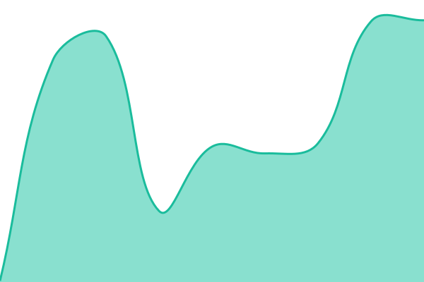
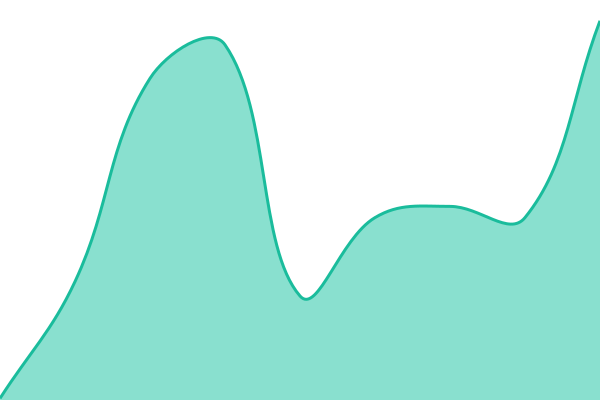

# [📈 Status agora](https://status.yoodash.com.br): <!--live status--> **🟧 Partial outage**

This repository contains the open-source uptime monitor and status page for [P4C Group](https://status.yoodash.com.br), powered by [Upptime](https://github.com/upptime/upptime).

With [Upptime](https://upptime.js.org), you can get your own unlimited and free uptime monitor and status page, powered entirely by a GitHub repository. We use [Issues](https://github.com/p4c-group/status-yoodash/issues) as incident reports, [Actions](https://github.com/p4c-group/status-yoodash/actions) as uptime monitors, and [Pages](https://status.yoodash.com.br) for the status page.

## [📈 Live Status](https://demo.upptime.js.org): <!--live status--> **🟧 Partial outage**

<!--start: status pages-->
<!-- This summary is generated by Upptime (https://github.com/upptime/upptime) -->
<!-- Do not edit this manually, your changes will be overwritten -->
<!-- prettier-ignore -->
| URL | Status | History | Response Time | Uptime |
| --- | ------ | ------- | ------------- | ------ |
|  [Aplicativo](https://app.yoodash.com.br/auth/sign-in) | Operacional | [aplicativo.yml](https://github.com/p4c-group/status-yoodash/commits/HEAD/history/aplicativo.yml) | 

 807ms
     
 | 

<a href="https://status.yoodash.com.br/history/aplicativo">95.88%</a>
    

|  [API](https://api.yoodash.com.br/health) | Operacional | [api.yml](https://github.com/p4c-group/status-yoodash/commits/HEAD/history/api.yml) | 

 646ms
     
 | 

<a href="https://status.yoodash.com.br/history/api">95.93%</a>
    

|  [Formulários e feeds](https://public.yoodash.com.br) | Operacional | [formularios-e-feeds.yml](https://github.com/p4c-group/status-yoodash/commits/HEAD/history/formularios-e-feeds.yml) | 

 388ms
     
 | 

<a href="https://status.yoodash.com.br/history/formularios-e-feeds">100.00%</a>
    

|  Sincronização de dados | Fora do ar | [sincronizacao-de-dados.yml](https://github.com/p4c-group/status-yoodash/commits/HEAD/history/sincronizacao-de-dados.yml) | 

 382ms
     
 | 

<a href="https://status.yoodash.com.br/history/sincronizacao-de-dados">79.04%</a>
    

|  Plataformas de e-commerce | Fora do ar | [plataformas-de-e-commerce.yml](https://github.com/p4c-group/status-yoodash/commits/HEAD/history/plataformas-de-e-commerce.yml) | 

 261ms
     
 | 

<a href="https://status.yoodash.com.br/history/plataformas-de-e-commerce">79.05%</a>
    

|  Mercado Livre | Fora do ar | [mercado-livre.yml](https://github.com/p4c-group/status-yoodash/commits/HEAD/history/mercado-livre.yml) | 

 261ms
     
 | 

<a href="https://status.yoodash.com.br/history/mercado-livre">79.07%</a>
    

|  Shopee | Fora do ar | [shopee.yml](https://github.com/p4c-group/status-yoodash/commits/HEAD/history/shopee.yml) | 

 277ms
     
 | 

<a href="https://status.yoodash.com.br/history/shopee">79.08%</a>
    

|  Anymarket | Fora do ar | [anymarket.yml](https://github.com/p4c-group/status-yoodash/commits/HEAD/history/anymarket.yml) | 

 299ms
     
 | 

<a href="https://status.yoodash.com.br/history/anymarket">79.10%</a>
    

|  Google Ads | Fora do ar | [google-ads.yml](https://github.com/p4c-group/status-yoodash/commits/HEAD/history/google-ads.yml) | 

 264ms
     
 | 

<a href="https://status.yoodash.com.br/history/google-ads">79.11%</a>
    

|  Meta Ads | Fora do ar | [meta-ads.yml](https://github.com/p4c-group/status-yoodash/commits/HEAD/history/meta-ads.yml) | 

 263ms
     
 | 

<a href="https://status.yoodash.com.br/history/meta-ads">79.13%</a>
    

|  TikTok Ads | Fora do ar | [tik-tok-ads.yml](https://github.com/p4c-group/status-yoodash/commits/HEAD/history/tik-tok-ads.yml) | 

 280ms
     
 | 

<a href="https://status.yoodash.com.br/history/tik-tok-ads">79.14%</a>
    

|  Google Analytics 4 | Fora do ar | [google-analytics-4.yml](https://github.com/p4c-group/status-yoodash/commits/HEAD/history/google-analytics-4.yml) | 

 261ms
     
 | 

<a href="https://status.yoodash.com.br/history/google-analytics-4">79.16%</a>
    

|  Google Search Console | Fora do ar | [google-search-console.yml](https://github.com/p4c-group/status-yoodash/commits/HEAD/history/google-search-console.yml) | 

 297ms
     
 | 

<a href="https://status.yoodash.com.br/history/google-search-console">79.17%</a>
    

<!--end: status pages-->

[**Visit our status website →**](https://status.yoodash.com.br)

## 📄 License

- Powered by: [Upptime](https://github.com/upptime/upptime)
- Code: [MIT](./LICENSE) © [Anand Chowdhary](https://anandchowdhary.com)
- Data in the `./history` directory: [Open Database License](https://opendatacommons.org/licenses/odbl/1-0/)
